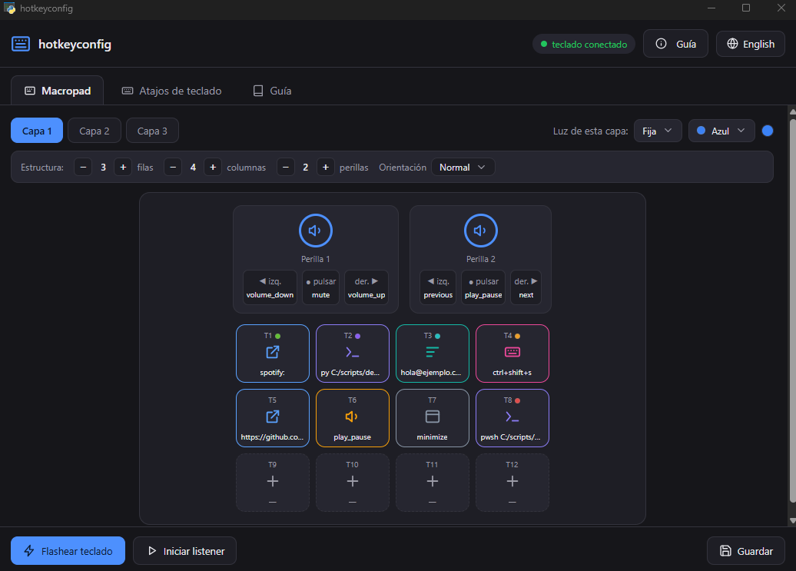
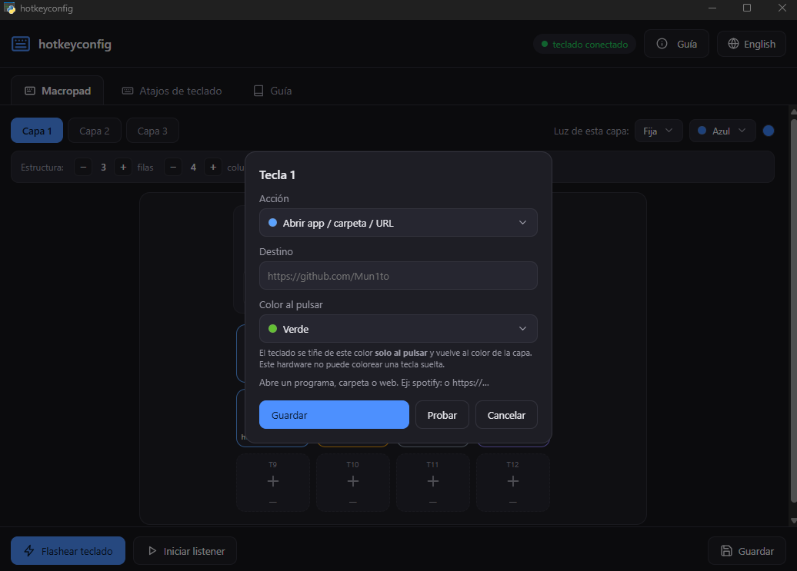
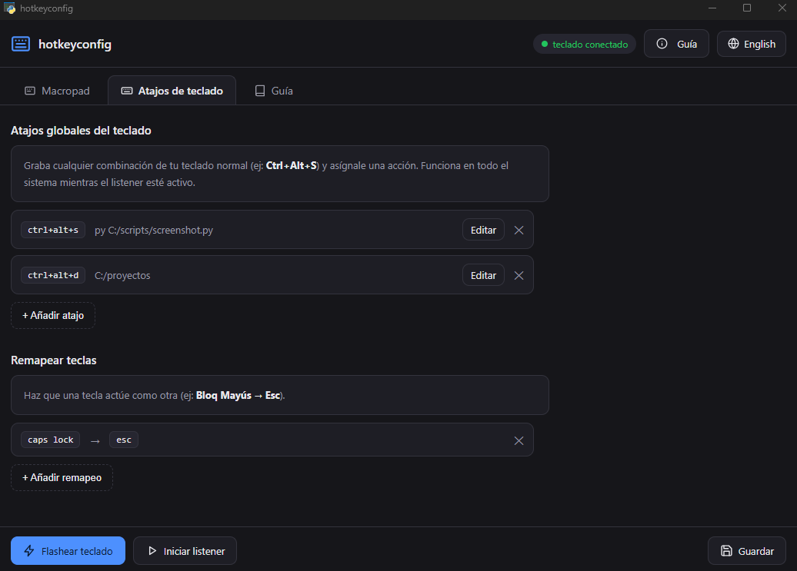
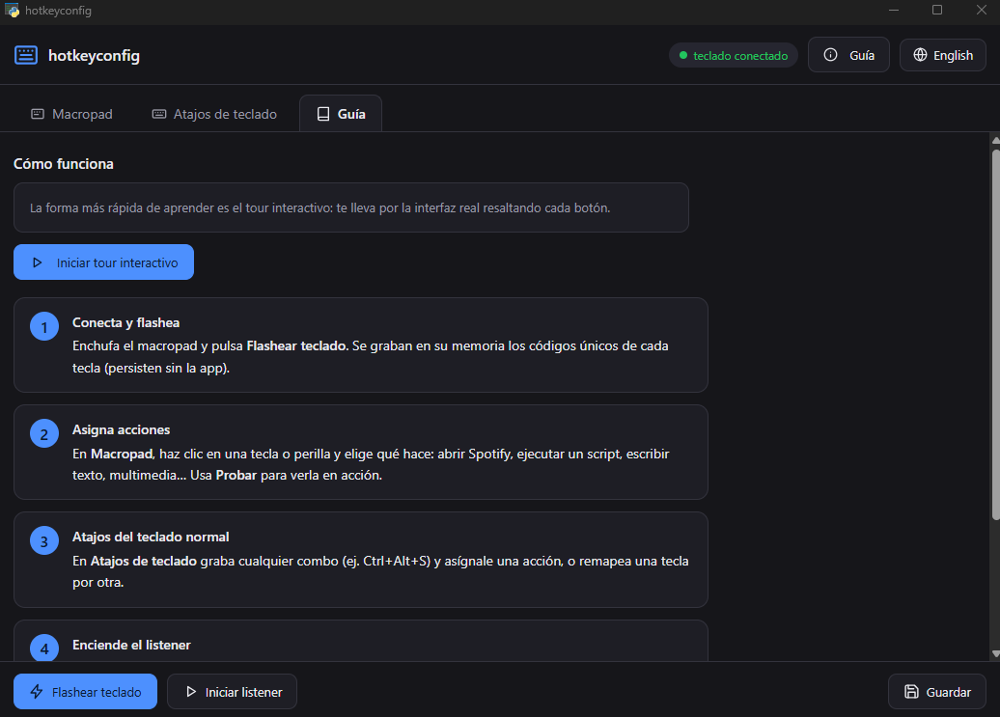

<div align="center">


# hotkeyconfig

**Cada tecla, a tu manera.** Convierte un macropad barato de AliExpress en un panel donde **cada tecla ejecuta lo que tú quieras**.

🌍 [English](README.md) · Español

<p>
  <a href="https://github.com/Mun1to/hotkeyconfig/releases/latest">
    
  </a>
  <a href="LICENSE">
    
  </a>
  <a href="SECURITY.md">
    
  </a>
</p>

<p>
  <a href="https://github.com/Mun1to/hotkeyconfig/releases/latest/download/hotkeyconfig-setup.exe">
    
  </a>
</p>

</div>

---

## ✨ Qué hace

Esos macropads `1189:8842` de AliExpress (12 teclas, 2 perillas, 3 capas) vienen con un software
propietario que te pasan por un enlace de Google Drive. `hotkeyconfig` lo sustituye por una app de
escritorio open source que programa el teclado **por HID nativo de Windows** y luego ejecuta tus
acciones.

- 🎹 **Cada tecla y perilla hace lo que quieras**: ejecutar scripts, abrir apps, carpetas o URLs,
  escribir texto, controlar multimedia, enviar atajos, manejar ventanas o encadenar varias acciones.
- ⌨️ **También tu teclado normal**: graba cualquier combinación (por ejemplo `Ctrl+Alt+S`) y
  asígnale una acción, y **remapea teclas sueltas** (`Bloq Mayús` a `Esc`).
- 🌈 **Iluminación RGB**: color y modo (fija, al pulsar, onda) por capa, grabados en el teclado.
- 💡 **Color por acción**: dale un color a un control y el teclado se tiñe de ese color al
  pulsarlo, volviendo después al color de la capa. Ojo, es **solo al pulsar**: el ch57x no puede
  mantener un color distinto en cada tecla (ver [docs/PROTOCOL.md](docs/PROTOCOL.md)), y hace
  falta tener el listener en marcha.
- 🧩 **Layout configurable**: filas, columnas, perillas y orientación, para encajar con otros
  modelos ch57x.
- 🖥️ **App de escritorio de verdad**: editor visual, tema claro/oscuro que sigue al del sistema,
  español e inglés, arranque con Windows, instalador y **actualizaciones automáticas**.
- 🔒 **Privada por diseño**: sin telemetría, sin llamadas de red en el listener y **no es un
  keylogger** (ver [SECURITY.md](SECURITY.md)).

---

## 📸 Capturas

<div align="center">
  
</div>

<p align="center"><em>Pantalla principal: capas, luz RGB por capa, ajuste de estructura al vuelo y cada tecla mostrando la acción que tiene asignada.</em></p>

| Editor de acciones | Atajos de teclado | Guía interactiva |
| :--: | :--: | :--: |
|  |  |  |

---

## ⬇️ Descargar

**[Descargar el instalador de Windows](https://github.com/Mun1to/hotkeyconfig/releases/latest/download/hotkeyconfig-setup.exe)**
o mira [todas las descargas](https://github.com/Mun1to/hotkeyconfig/releases/latest).

El instalador no pide administrador, crea los accesos directos y ofrece una casilla para arrancar
con Windows. Tu configuración se guarda en `%LOCALAPPDATA%\hotkeyconfig\profile.yaml`.

> Puede que SmartScreen avise de editor desconocido: la app todavía no está firmada. Pulsa
> **Más información** y luego **Ejecutar de todas formas**, o compílala tú desde el código
> (instrucciones más abajo).

## 🔄 Actualizaciones automáticas

La app consulta los releases de GitHub y te ofrece la nueva versión en un aviso. Las
actualizaciones se descargan **solo por HTTPS desde GitHub** y se **verifica su SHA256** antes de
ejecutar nada.

---

## 🎹 Hardware compatible

Macropads con el chip **ch57x** (también vendidos como k884x), identificados por USB como
`1189:8842`. El modelo habitual es de **12 teclas + 2 perillas + 3 capas**, pero el layout es
configurable, así que también valen otros tamaños.

```
 [ T1 ][ T2 ][ T3 ][ T4 ]      ( P1 )
 [ T5 ][ T6 ][ T7 ][ T8 ]      ( P2 )
 [ T9 ][T10 ][T11 ][T12 ]
   12 teclas             2 perillas (giro + clic)
```

Cada perilla tiene tres acciones: girar a la izquierda, pulsar y girar a la derecha.

---

## ⌨️ Cómo se usa

1. **Enchufa el macropad** y pulsa **Flashear teclado**. Eso graba un código único por tecla en la
   memoria del propio teclado. Solo hay que hacerlo una vez y persiste sin la app.
2. **Haz clic en una tecla o perilla** y elige qué hace. Pulsa **Probar** para verlo al momento.
3. **Pulsa Iniciar listener** para que tus acciones respondan. Activa el arranque con Windows y
   olvídate.

> La parte única vive **en la memoria del teclado**, así que persiste. El listener solo hace falta
> para **ejecutar tus acciones**: si no está en marcha, esas acciones simplemente no se disparan.

### Tipos de acción

| `type` | Qué hace | Campos |
|--------|----------|--------|
| `run` | Ejecuta un script o comando | `cmd` o `args`, `cwd`, `shell` |
| `open` | Abre una app, carpeta o URL | `target` |
| `text` | Escribe o pega texto | `text` |
| `media` | Tecla multimedia, gestionada por la app | `key` |
| `hotkey` | Manda un atajo a la app activa | `send` |
| `window` | Minimiza, maximiza, restaura, cierra | `do` |
| `sequence` | Varias acciones en orden | `steps` |
| `native` | Se graba en el hardware (volumen, etc.) | `key` |
| `unassigned` | No hace nada | (ninguno) |

---

## 🧠 Cómo funciona

Estos macropads no exponen un identificador por tecla: mandan **pulsaciones HID estándar**, igual
que cualquier teclado. Para que cada tecla sea **única** hay que hacerle enviar una combinación que
ningún teclado físico produce.

`hotkeyconfig` usa las teclas fantasma `F13` a `F24` con una familia de modificadores distinta por
capa, lo que da **54 combos sin colisión** (12 teclas x 3 capas, más 2 perillas x 3 acciones x 3
capas). Un listener local asocia cada combo con tu acción. Como cada combo es único, el runtime no
necesita saber qué capa está activa: ya la ha cambiado el hardware.

Por eso el proyecto son dos mitades:

1. **Grabar los combos en el teclado**, por **HID nativo de Windows**, igual que hace la
   herramienta propietaria: **sin Zadig, sin drivers, sin Rust**. El protocolo está portado byte a
   byte desde [`kriomant/ch57x-keyboard-tool`](https://github.com/kriomant/ch57x-keyboard-tool),
   que queda como backend alternativo opcional.
2. **Escuchar esos combos y ejecutar acciones**, con un listener local basado en la librería
   [`keyboard`](https://pypi.org/project/keyboard/), en un icono de bandeja.

---

## 🔒 Privacidad

- El listener **solo** reacciona a los combos `F13` a `F24` configurados.
- **No** registra, almacena ni transmite tus pulsaciones normales, y **no** hace llamadas de red.
- El actualizador es lo único que usa la red, y únicamente contra GitHub.

Todo el detalle, la política de dependencias y el estado de auditoría en [SECURITY.md](SECURITY.md).

---

## 🛠️ Para desarrolladores

Solo hace falta Python 3.11+ (nada de Rust):

```bash
python -m venv .venv
.venv\Scripts\pip install -e .
```

Línea de comandos:

```bash
hotkeyconfig detect              # ¿teclado conectado?
hotkeyconfig generate            # crea config/profile.yaml con los combos únicos
hotkeyconfig flash               # graba los combos en la memoria del teclado
hotkeyconfig run                 # escucha y ejecuta (icono en la bandeja)
hotkeyconfig gui                 # abre el configurador visual
hotkeyconfig autostart install   # arrancar con Windows
```

Compilar la app autónoma y el instalador (PyInstaller + Inno Setup):

```bash
.venv\Scripts\pip install -e ".[dev]"
.venv\Scripts\python scripts/build.py              # dist\hotkeyconfig\hotkeyconfig.exe
.venv\Scripts\python scripts/build.py --installer  # + dist\hotkeyconfig-<version>-setup.exe
```

Regenerar las capturas del README (abre la app con un perfil de demostración, nunca toca el tuyo):

```bash
.venv\Scripts\python scripts/screenshots.py
```

Ejemplo de perfil: [`config/profile.example.yaml`](config/profile.example.yaml). Notas del
protocolo: [`docs/PROTOCOL.md`](docs/PROTOCOL.md).

---

## 🧭 Hoja de ruta

- **Más teclados.** Hoy solo se admite la familia ch57x (`1189:8842`, k884x), porque el protocolo
  de configuración es específico de cada modelo. El siguiente es el **K8850** (`514c:8850`, 16
  teclas y 3 perillas), que además es interesante por sí mismo: ese sí admite **RGB real por
  tecla**, algo que el k884x no puede hacer de ninguna manera.
- **Firmar el ejecutable**, para quitar el aviso de SmartScreen.

¿Tienes otro macropad y quieres que funcione? Abre un issue con su identificador USB
(`hotkeyconfig detect`) y, si puedes, una captura USB del software del fabricante
configurándolo.

## 📄 Licencia y créditos

MIT, ver [LICENSE](LICENSE).

El protocolo k884x está portado desde
[`ch57x-keyboard-tool`](https://github.com/kriomant/ch57x-keyboard-tool) (MIT, de `kriomant`),
enviado por HID nativo en lugar de libusb. Listener basado en
[`keyboard`](https://pypi.org/project/keyboard/).
