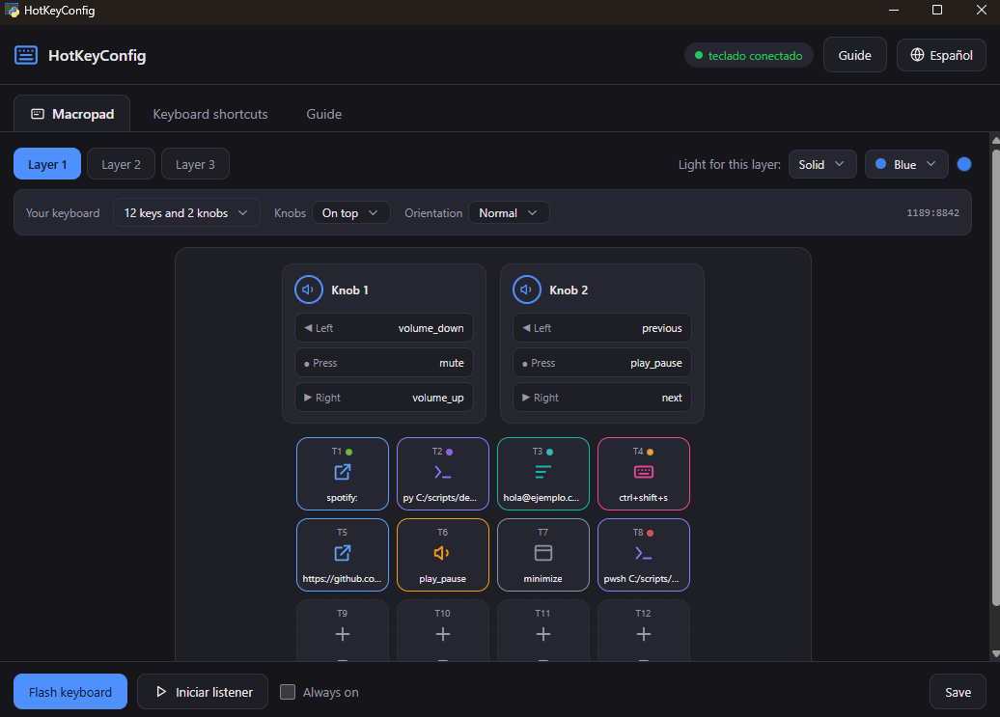
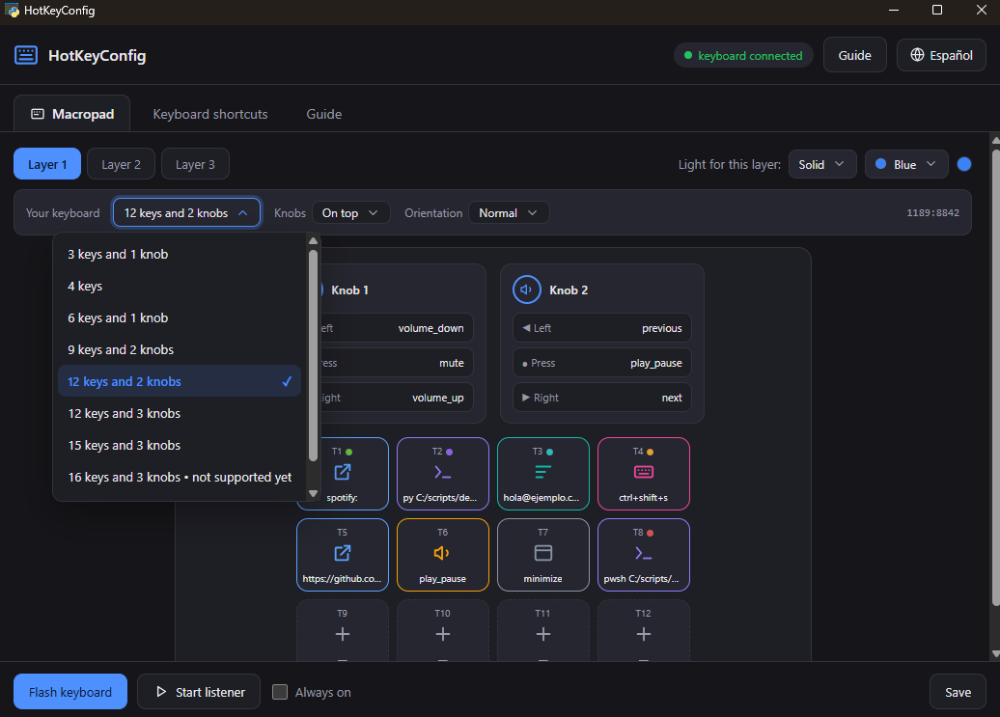
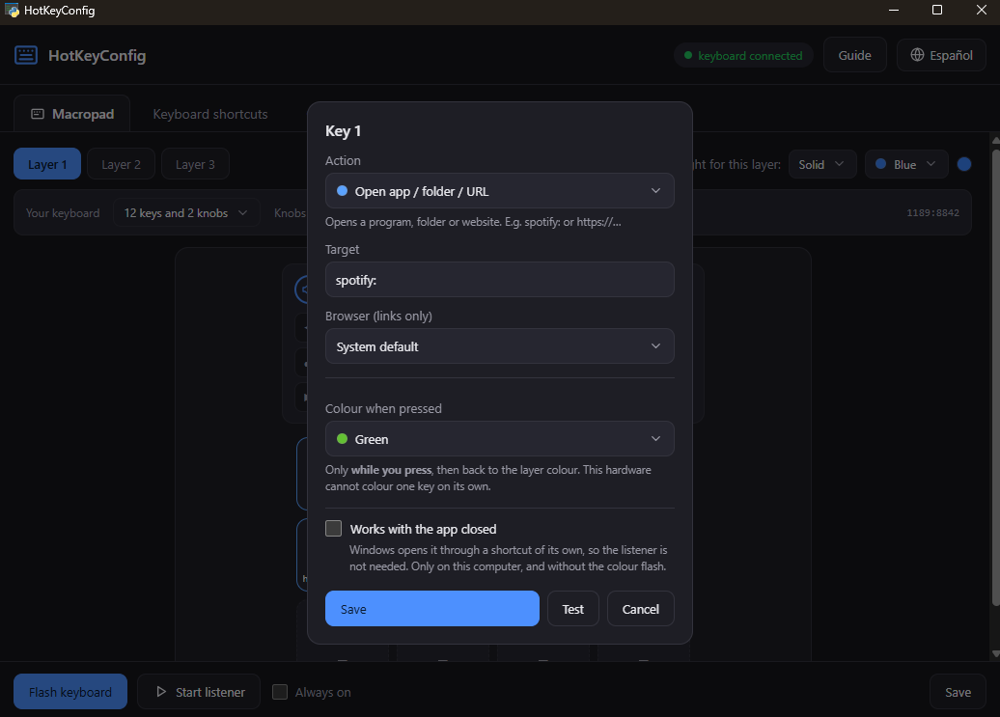
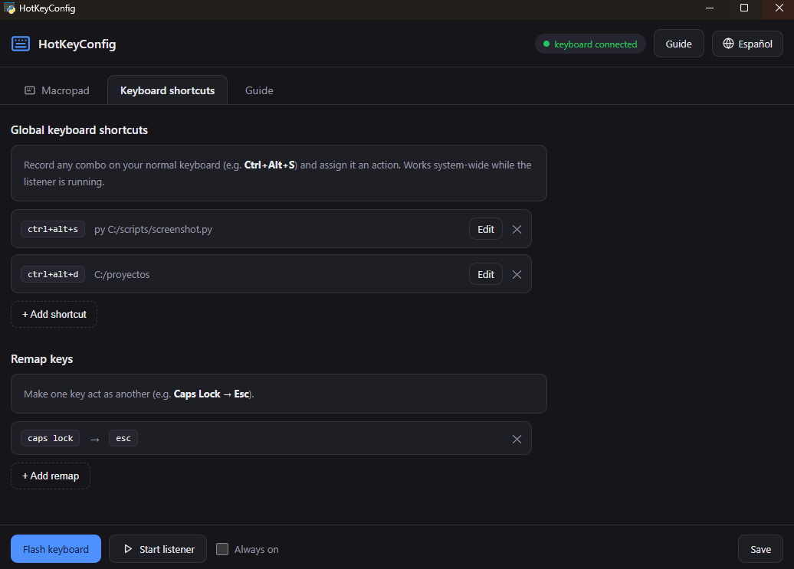
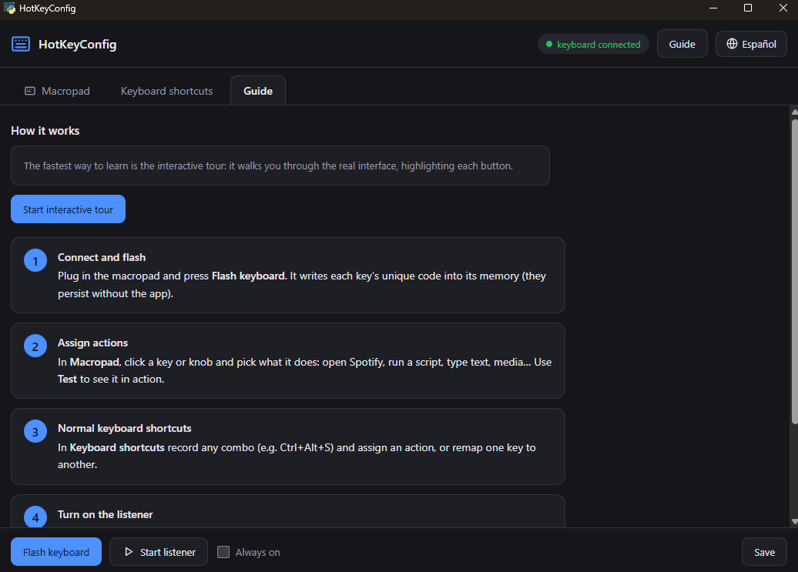

<div align="center">


# HotKeyConfig

**Every key, your way.** Turn a cheap AliExpress macropad into a control panel where **every key runs whatever you want**.

🌍 English · [Español](README.es.md)

<p>
  <a href="https://github.com/Mun1to/hotkeyconfig/releases/latest">
    
  </a>
  <a href="LICENSE">
    
  </a>
  <a href="SECURITY.md">
    
  </a>
</p>

<p>
  <a href="https://github.com/Mun1to/hotkeyconfig/releases/latest/download/hotkeyconfig-setup.exe">
    
  </a>
</p>

</div>

---

## ✨ What it does

Those `1189:8842` macropads from AliExpress (12 keys, 2 knobs, 3 layers) ship with proprietary
software handed out through a Google Drive link. `hotkeyconfig` replaces it with an open source
desktop app that programs the keyboard **over native Windows HID**, then runs your actions.

- 🎹 **Every key and knob does what you want**: run scripts, open apps, folders or URLs, type text,
  control media, send shortcuts, operate windows, or chain several actions in sequence.
- ⌨️ **Your normal keyboard too**: record any combo (say `Ctrl+Alt+S`) and bind an action to it, and
  **remap single keys** (`Caps Lock` to `Esc`).
- 🌈 **RGB lighting**: color and mode (solid, on press, wave) per layer, written into the keyboard.
- 💡 **Colour feedback per action**: give a control a colour and the keyboard flashes it when you
  press it, then goes back to the layer colour. Note this is **only while pressing**: the ch57x
  cannot hold a different colour on each key (see [docs/PROTOCOL.md](docs/PROTOCOL.md)), and it
  needs the listener running.
- 🧩 **Pick your keyboard from a list**: eight shapes, from 3 keys and a knob up to 16 and three,
  with the knobs where you actually have them.
- 🚪 **Keys that work with the app closed**: opening a program or a link can be handed over to
  Windows, and it responds without the listener (see below, it has its limits).
- 🖥️ **Real desktop app**: visual editor, light/dark theme that follows your system, English and
  Spanish, start with Windows, installer and **automatic updates**.
- 🔒 **Private by design**: no telemetry, no network calls in the listener, and it is **not a
  keylogger** (see [SECURITY.md](SECURITY.md)).

---

## 📸 Screenshots

<div align="center">
  
</div>

<p align="center"><em>Main screen: layers, per layer RGB light, your keyboard picked from a list, and every key showing the action bound to it.</em></p>

| Pick your keyboard | Action editor |
| :--: | :--: |
|  |  |
| Choose it by what you can count, keys and knobs. | Every action, its colour, and whether it should work with the app closed. |

| Keyboard shortcuts | Interactive guide |
| :--: | :--: |
|  |  |

---

## ⬇️ Download

**[Download the Windows installer](https://github.com/Mun1to/hotkeyconfig/releases/latest/download/hotkeyconfig-setup.exe)**
or browse [all releases](https://github.com/Mun1to/hotkeyconfig/releases/latest).

The installer does not require administrator rights, creates the shortcuts and offers a checkbox to
start with Windows. Your configuration lives in `%LOCALAPPDATA%\hotkeyconfig\profile.yaml`.

> Windows SmartScreen may warn about an unknown publisher: the app is not code signed yet. Choose
> **More info** and then **Run anyway**, or build it yourself from source (instructions below).

## 🔄 Automatic updates

The app checks GitHub Releases and offers the new version in a banner. Updates are downloaded over
**HTTPS from GitHub only** and their **SHA256 is verified** before anything is executed.

---

## 🎹 Supported hardware

Macropads built on the **ch57x** chip family. These boards are sold under dozens of names with no
model number printed anywhere, so pick yours in the app by what you can count: how many keys and
how many knobs.

| Shape | Keys | Knobs | Status |
|-------|------|-------|--------|
| 3 keys and 1 knob | 3 | 1 | supported [^mod] |
| 4 keys | 4 | 0 | supported |
| 6 keys and 1 knob | 6 | 1 | supported |
| 9 keys and 2 knobs | 9 | 2 | supported |
| **12 keys and 2 knobs** | 12 | 2 | **supported, verified on real hardware** |
| 12 keys and 3 knobs | 12 | 3 | supported |
| 15 keys and 3 knobs | 15 | 3 | supported |
| 16 keys and 3 knobs | 16 | 3 | not yet, needs its own protocol |

[^mod]: On this one the firmware only stores the modifiers of the first key in a sequence.

By USB identifier: `1189:8840`, `1189:8842`, `1189:8850` and `514c:8851` speak the protocol this
program implements. `1189:8890` and `514c:8850` are recognised and named, but not programmable yet:
they use different protocols. If you own one, [say so in an issue](https://github.com/Mun1to/hotkeyconfig/issues)
and bring a USB capture if you can, that is what makes adding it possible.

Only the 12 keys and 2 knobs model has been verified against real hardware, which is the one its
author owns. The rest share the same protocol and should work; reports are welcome either way.

```
 [ T1 ][ T2 ][ T3 ][ T4 ]      ( K1 )
 [ T5 ][ T6 ][ T7 ][ T8 ]      ( K2 )
 [ T9 ][T10 ][T11 ][T12 ]
   12 keys                2 knobs (turn + click)
```

Every knob has three actions: turn left, press, turn right.

---

## ⌨️ How to use it

1. **Plug in the macropad** and press **Flash keyboard**. This writes a unique code for every key
   into the keyboard's own memory. It only has to be done once, and it survives without the app.
2. **Click any key or knob** and pick what it does. Press **Test** to try it right away.
3. **Tick "Always on"** and forget about it: the listener starts with Windows, so your keys answer
   with this window closed and after a restart. Or use **Start listener** for just this session.

> The unique part lives **in the keyboard's memory**, so it persists. The listener is only needed to
> **run your actions**: if it is not running, those actions simply do not fire.

### Action types

| `type` | What it does | Fields |
|--------|--------------|--------|
| `run` | Runs a script or command | `cmd` or `args`, `cwd`, `shell` |
| `open` | Opens an app, folder or URL | `target`, `browser` |
| `text` | Types or pastes text | `text` |
| `media` | Media key, handled by the app | `key` |
| `hotkey` | Sends a shortcut to the active app | `send` |
| `window` | Minimize, maximize, restore, close | `do` |
| `sequence` | Several actions in order | `steps` |
| `native` | Written into the hardware (volume and so on) | `key` |
| `unassigned` | Does nothing | (none) |

### Making a key work with the app closed

The listener is what runs your actions: without it a key sends its combo and nothing happens. For
**open** actions there is a way out, ticking **Works with the app closed** in the key editor. The
program then creates a Windows shortcut with that combo assigned to it, and what answers is
Explorer, which is always running anyway.

Worth knowing before relying on it:

- Only for **opening** programs, folders and links. Typing text, running scripts and the colour
  flash still need the listener.
- Not for **knobs**: their combos include the Windows key, which Windows rejects on a shortcut.
- **It is not stored in the keyboard.** The configuration lives in Windows, in that shortcut. On
  another computer the keyboard will still send its combo and nothing will happen there. No program
  can change that: a macropad only knows how to send keystrokes.
- Moving a key's shortcut around repeatedly can leave Windows holding the old association, and that
  combo stops responding until Explorer or the machine restarts.

> On `open`: leave `browser` empty and links follow your system default. Set it to the name of an
> installed browser (the interface lists the ones it finds) and links always open there. Either way
> the window is brought to the front, so a key press takes you to what you just opened instead of
> leaving it behind whatever you were working on.

---

## 🧠 How it works

These macropads do not expose a per key identifier: they send **standard HID keystrokes**, exactly
like any keyboard. To make each key **unique** it has to send a combo no physical keyboard produces.

`hotkeyconfig` uses the phantom keys `F13` to `F24` with a different modifier family per layer,
which yields **54 collision free combos** (12 keys x 3 layers, plus 2 knobs x 3 actions x 3 layers).
A local listener maps every combo to your action. Because each combo is unique, the runtime never
needs to track which layer is active: the hardware already switched it.

So the project is two halves:

1. **Writing the combos into the keyboard**, over **native Windows HID**, the same way the
   proprietary tool does: **no Zadig, no drivers, no Rust**. The protocol is ported byte for byte
   from [`kriomant/ch57x-keyboard-tool`](https://github.com/kriomant/ch57x-keyboard-tool), which
   remains available as an optional alternative backend.
2. **Listening for those combos and running actions**, with a local listener built on the
   [`keyboard`](https://pypi.org/project/keyboard/) library, living in a tray icon.

---

## 🔒 Privacy

- The listener **only** reacts to the configured `F13` to `F24` combos.
- It does **not** record, store or transmit your normal keystrokes, and makes **no** network calls.
- The updater is the only component that talks to the network, and only to GitHub.

Full detail, dependency policy and audit status in [SECURITY.md](SECURITY.md).

---

## 🛠️ For developers

Python 3.11+ is all you need (no Rust):

```bash
python -m venv .venv
.venv\Scripts\pip install -e .
```

Command line:

```bash
hotkeyconfig detect              # is the keyboard connected?
hotkeyconfig generate            # create config/profile.yaml with the unique combos
hotkeyconfig flash               # write the combos into the keyboard's memory
hotkeyconfig run                 # listen and execute (tray icon)
hotkeyconfig gui                 # open the visual configurator
hotkeyconfig autostart install   # start with Windows
```

Build the standalone app and the installer (PyInstaller + Inno Setup):

```bash
.venv\Scripts\pip install -e ".[dev]"
.venv\Scripts\python scripts/build.py              # dist\hotkeyconfig\hotkeyconfig.exe
.venv\Scripts\python scripts/build.py --installer  # + dist\hotkeyconfig-<version>-setup.exe
```

Regenerate the README screenshots (opens the app with a demo profile, never touches yours):

```bash
.venv\Scripts\python scripts/screenshots.py
```

Profile example: [`config/profile.example.yaml`](config/profile.example.yaml). Protocol notes:
[`docs/PROTOCOL.md`](docs/PROTOCOL.md).

---

## 🧭 Roadmap

- **More keyboards.** Today only the ch57x family (`1189:8842`, k884x) is supported, because the
  configuration protocol is specific to each model. The next one is the **K8850**
  (`514c:8850`, 16 keys and 3 knobs), which is interesting on its own: it does support **true
  per-key RGB**, something the k884x cannot do at all.
- **Code signing**, to drop the SmartScreen warning.

Got a different macropad and want it supported? Open an issue with its USB id (`hotkeyconfig
detect`) and, if you can, a USB capture of the vendor software configuring it.

## 📄 License and credits

MIT, see [LICENSE](LICENSE).

The k884x protocol is ported from [`ch57x-keyboard-tool`](https://github.com/kriomant/ch57x-keyboard-tool)
(MIT, by `kriomant`), sent over native HID instead of libusb. Listener built on
[`keyboard`](https://pypi.org/project/keyboard/).
